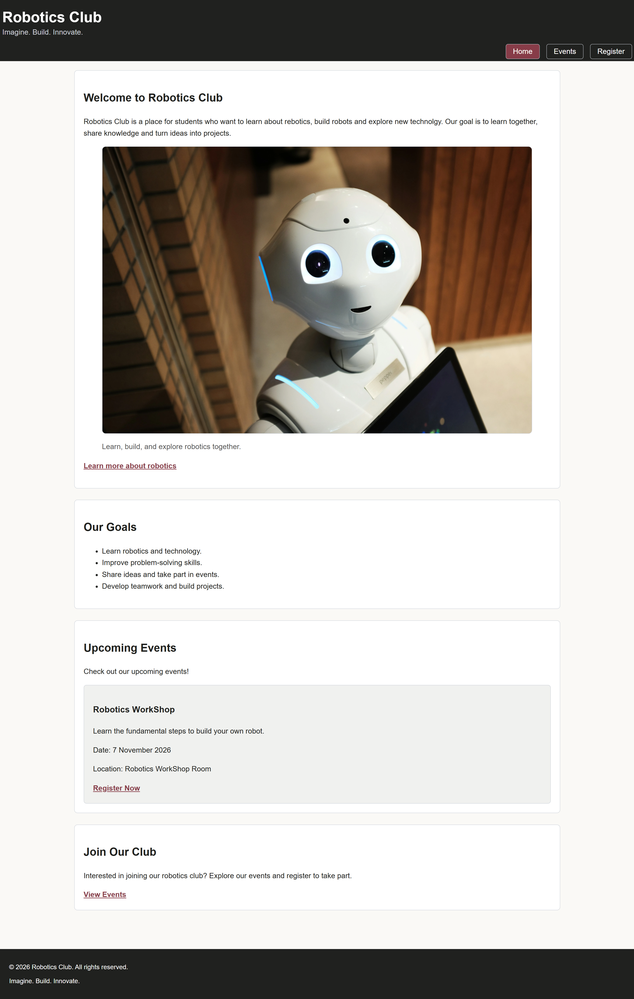
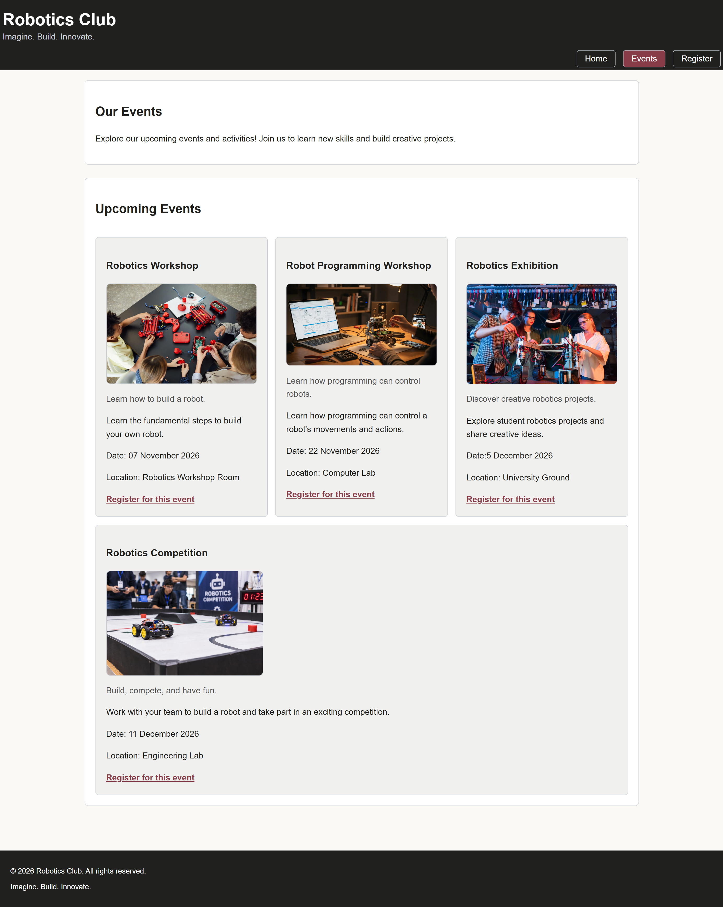
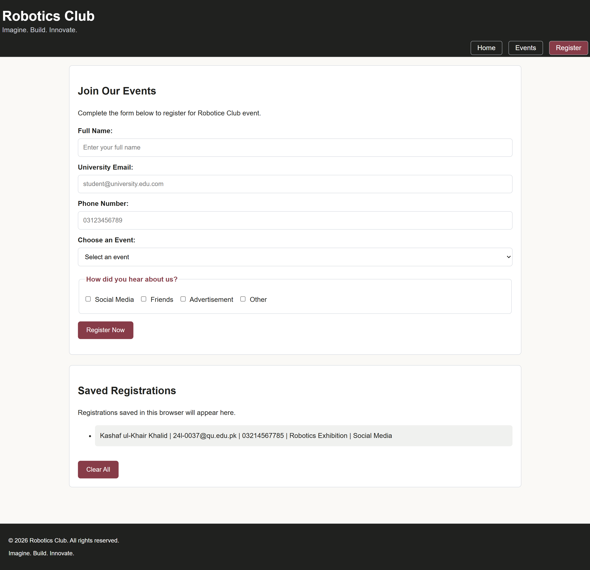

# cit331-assignment1-24l-bscs-0037
# Robotics Club
## About
Robotics Club is for students who want to learn robotics and build robots. Students can share ideas, learn new things, work together and take part in robotics events.

## Pages

- **Home (`index.html`):** Its tells about the club and its goals.
- **Events (`events.html`):** Its shows upcoming events, dates, and locations.
- **Register (`register.html`):** In this students register for events and see their saved registrations.

## How to Open the Website

1. Open the website folder in Visual Studio Code.

2. Make sure all html, css, javascript and image files are in the folder.

3. Double-click in index.html

4. It will open in your browser like google

5. Click home, events and register in the navigation menu to visit each page.

## Pages Screenshot

